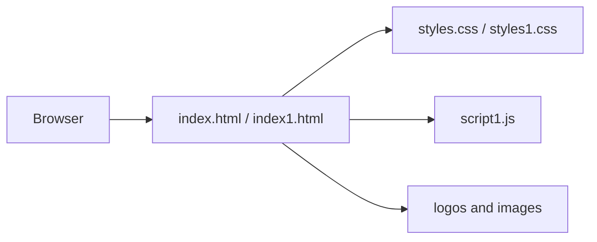

# CodeBreakers VVCE

A static HTML/CSS/JavaScript website for the CodeBreakers VVCE project or event. It contains multiple landing-page variants, branding assets, and browser-side interactions; there is no server or package manifest in the repository.

## Architecture



## Run locally

Because this is a static site, use any local static server rather than opening files directly when browser APIs or relative assets are involved:

```bash
python -m http.server 8000
# open http://localhost:8000
```

## Content and data

Pages are rendered from committed HTML and image assets. `script1.js` provides client-side behavior; there is no documented backend API, database, authentication, or form-processing service.

## Deployment

Publish the repository root to GitHub Pages, Netlify, Vercel static hosting, or an object-storage/CDN origin. Set the site root to the directory containing `index.html`; preserve case-sensitive asset paths.

## Validation

Check both page variants at desktop and mobile widths, verify all images load, and inspect the browser console for broken links or JavaScript errors. No automated test command is configured.

## Security and operations

- Keep credentials, database URLs, OAuth tokens, API keys, and signing secrets in environment variables; never commit them.
- Validate and constrain uploaded files and user input at the server boundary, and enable HTTPS in production.
- Review dependency updates and rotate any credential that has appeared in repository history.

## Testing

The repository currently has no comprehensive automated test suite unless noted above. Before production changes, add tests for authentication/authorization, validation failures, persistence errors, and the primary user workflow.

## Limitations and roadmap

This is an actively evolving project. Production hardening, observability, rate limiting, backup/retention policy, and accessibility/performance validation should be completed before handling sensitive or high-volume workloads.

## License

See the repository license file and package metadata for the authoritative terms.
## Implementation notes

This repository is a static VVCE-branded site with two page variants (`index.html` and `index1.html`), two stylesheet variants, `script1.js`, and committed image assets. `DroidCam.Setup.6.5.2.exe` is a distributable binary, not a build dependency; review whether it belongs in a release artifact before publishing. The HTML does not expose a server API or persistence layer.

### Verification

Run `python -m http.server 8000` from the repository root and verify both entry points, relative image paths, responsive layouts, and browser-console output. There is no package manager or automated test runner.

### License status

`LICENSE` is the authoritative license for this repository. Asset and binary redistribution rights should be confirmed separately before mirroring the site or shipping the installer.
